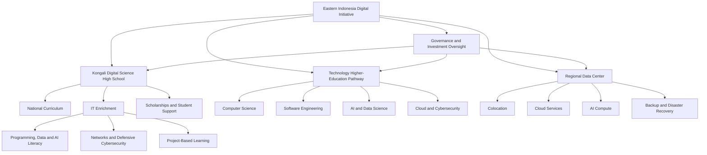
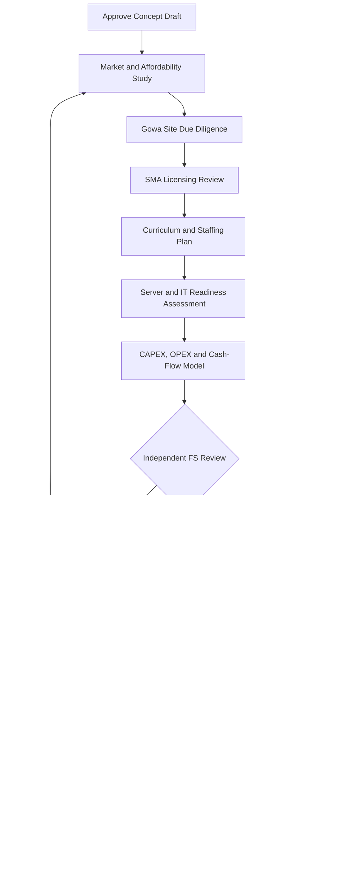

<p align="center">
  
</p>

<h1 align="center">Eastern Indonesia Digital Education & Data Center Initiative</h1>

<p align="center">
  <strong>Education · Artificial Intelligence · Cybersecurity · Cloud Computing · Digital Infrastructure</strong>
</p>

<p align="center">
  
  
  
  
</p>

<p align="center">
  <a href="https://kongali1720.co.id/kongali-server/dashboard.html">Kongali Server Dashboard</a> ·
  <a href="https://github.com/kongali1720">GitHub Profile</a>
</p>


<p align="center">
  
</p>

<h1 align="center">Eastern Indonesia Digital Education & Data Center Initiative</h1>

<p align="center">
  <strong>SMA Teknologi • Lembaga Kursus Digital • Universitas Masa Depan • Infrastruktur Digital</strong>
</p>

<p align="center">
  Gowa, Sulawesi Selatan, Indonesia
</p>

<p align="center">
  <em>Conceptual Masterplan — Proposed Development, Subject to Feasibility, Funding, and Regulatory Approval</em>
</p>

---

## Project Vision

The Eastern Indonesia Digital Education & Data Center Initiative is a
proposed phased development program focused on technology-oriented
secondary education, practical digital-skills training, and a potential
future university pathway in Eastern Indonesia.

The initial priority is the feasibility and development planning of
SMA IT in Gowa, followed by the potential establishment of a digital
skills course institution. A university pathway and regional data center
will be assessed as separate workstreams with independent feasibility,
governance, and funding decisions.

> **Planning principle:** Build the education foundation first, validate
> demand and financial sustainability, and expand only when the required
> evidence, funding, and approvals are in place.


## 1. Project Overview

The Eastern Indonesia Digital Education & Data Center Initiative is a proposed long-term development program to establish an IT-focused senior high school, a technology higher-education pathway, and a regional digital infrastructure ecosystem in South Sulawesi, Indonesia.

The initiative aims to develop a sustainable center for education, applied research, artificial intelligence, software engineering, cybersecurity, cloud computing, and digital infrastructure serving Eastern Indonesia.

The project is organized into three connected but financially and operationally distinct workstreams:

1. **Kongali Digital Science High School** — an IT-enriched senior high school proposed for Gowa, South Sulawesi.
2. **Kongali Institute of Technology** — a proposed technology higher-education pathway, subject to legal feasibility, institutional approvals, academic requirements, and funding.
3. **Eastern Indonesia Regional Data Center** — a proposed commercial and research infrastructure project with an initial development budget assumption of IDR 1.1 trillion.

The existing Kongali Server Dashboard will serve as a reference for evaluating the digital infrastructure available to support learning, laboratories, and research.

> **Project status:** Concept development and preliminary feasibility study (Pre-FS). No final site, construction contract, university license, funding commitment, or opening date is implied.

## 2. Vision and Mission

### Vision

To establish South Sulawesi as a leading education, research, and digital infrastructure hub for Eastern Indonesia.

### Mission

- Deliver high-quality, accessible, technology-enriched secondary education.
- Prepare students for higher education, responsible digital participation, and future employment.
- Develop technology-focused higher education and applied research pathways.
- Support AI, cybersecurity, software engineering, data science, and cloud computing.
- Develop local technology talent and create opportunities for students from different economic backgrounds.
- Build reliable digital infrastructure based on verified technical and commercial requirements.
- Establish transparent governance, responsible investment, academic quality, and sustainable operations.

## 3. Core Project Components

### 3.1 Kongali Digital Science High School

**Proposed location:** Gowa, South Sulawesi, Indonesia.

**Planned mature capacity:** 540 students.

The capacity assumption is based on six classes per grade, 30 students per class, across Grades X, XI, and XII. This is a planning scenario that must be validated against applicable requirements, site design, staffing, and market demand.

The school will combine the applicable Indonesian national curriculum with structured enrichment in:

- Computational thinking and programming.
- Software and web development.
- Artificial intelligence literacy and data analysis.
- Networks, Linux, cloud computing, and digital systems.
- Cybersecurity awareness and defensive practices.
- Electronics, robotics, and the Internet of Things.
- Digital design, entrepreneurship, and project management.
- Technical English, communication, teamwork, and ethics.

The educational model will serve a mix of fee-paying students and students receiving partial or full scholarships.

The school will prioritize academic quality, affordability, student welfare, practical projects, and transparent scholarship criteria.

### 3.2 Technology Higher-Education Pathway

**Proposed name:** Kongali Institute of Technology.

The long-term objective is to create a higher-education pathway focused on technology, computing, research, and digital innovation.

Potential academic areas include:

- Informatics and Computer Science.
- Software Engineering.
- Information Systems and Information Technology.
- Data Science and Artificial Intelligence.
- Cybersecurity and Digital Infrastructure.
- Cloud Computing and Distributed Systems.
- Digital Business and Technology Entrepreneurship.

The initial academic portfolio should be limited to programs with a viable legal route, qualified academic leadership, sufficient faculty, appropriate laboratories, validated demand, and sustainable funding.

The establishment of a new university or degree program must not be assumed to be automatically permitted. The project will seek written guidance from the competent higher-education authorities and evaluate lawful partnerships with existing licensed institutions.

### 3.3 Regional Data Center

**Proposed development budget:** IDR 1.1 trillion.

The budget is an initial project assumption, not an independently validated engineering estimate or contractor quotation.

Potential services include:

- Colocation and enterprise hosting.
- Cloud infrastructure and managed services.
- Backup and disaster recovery.
- AI and GPU computing.
- Research computing and university laboratories.
- Enterprise network and cybersecurity services.

The final design must be based on validated customer demand, IT capacity in megawatts, electrical infrastructure, cooling, connectivity, redundancy, physical security, environmental constraints, and operational costs.

The data center will have a separate financial model, legal structure where appropriate, procurement process, and investment approval. Its proposed budget is not included in the SMA education budget.

## 4. Feasibility Study Framework

The project will use a staged feasibility study covering the following workstreams:

| Workstream | Scope |
|---|---|
| Market Feasibility | Student demand, family affordability, education competitors, enterprise demand, and customer validation |
| Site Feasibility | Land title, zoning, access, utilities, environmental constraints, safety, and expansion |
| Academic Feasibility | Curriculum, learning outcomes, teachers, lecturers, laboratories, and academic quality |
| Legal Feasibility | Education licensing, entity structure, land and building approvals, and business compliance |
| Technical Feasibility | Server inventory, networks, power, cooling, systems, and operational resilience |
| Financial Feasibility | CAPEX, OPEX, working capital, revenue, cash flow, and funding scenarios |
| Operational Feasibility | Recruitment, management, student services, maintenance, and technology support |
| Environmental and Social Feasibility | Energy, water, waste, accessibility, safeguarding, and community impact |
| Governance and Risk | Audit, procurement, conflicts of interest, cybersecurity, and investment controls |

All financial projections and capacity assumptions must be classified as preliminary until supported by evidence.

## 5. Proposed GitHub Repository Structure

```text
eastern-indonesia-digital-initiative/
├── README.md
├── LICENSE
├── CONTRIBUTING.md
├── SECURITY.md
├── .gitignore
│
├── docs/
│   ├── executive-summary/
│   │   ├── project-vision.md
│   │   ├── project-scope.md
│   │   └── investment-overview.md
│   │
│   ├── feasibility-study/
│   │   ├── market-demand.md
│   │   ├── demographic-analysis.md
│   │   ├── competitor-analysis.md
│   │   ├── financial-feasibility.md
│   │   └── risk-assessment.md
│   │
│   ├── site-selection/
│   │   ├── regional-comparison.md
│   │   ├── campus-site-criteria.md
│   │   ├── data-center-site-criteria.md
│   │   └── utilities-and-connectivity.md
│   │
│   ├── education/
│   │   ├── sma/
│   │   │   ├── 01-project-concept.md
│   │   │   ├── academic-model.md
│   │   │   ├── curriculum.md
│   │   │   ├── laboratory-requirements.md
│   │   │   ├── staffing-plan.md
│   │   │   ├── admissions-scholarships.md
│   │   │   ├── market-feasibility.md
│   │   │   ├── site-selection.md
│   │   │   └── financial-feasibility.md
│   │   │
│   │   └── university/
│   │       ├── academic-structure.md
│   │       ├── proposed-programs.md
│   │       ├── curriculum-framework.md
│   │       ├── research-strategy.md
│   │       └── licensing-accreditation.md
│   │
│   ├── data-center/
│   │   ├── business-case.md
│   │   ├── technical-requirements.md
│   │   ├── power-and-cooling.md
│   │   ├── network-and-carriers.md
│   │   ├── security-and-resilience.md
│   │   └── operations-and-maintenance.md
│   │
│   ├── finance/
│   │   ├── capital-expenditure.md
│   │   ├── operating-expenditure.md
│   │   ├── revenue-model.md
│   │   ├── cash-flow-model.md
│   │   └── funding-strategy.md
│   │
│   ├── governance/
│   │   ├── organizational-structure.md
│   │   ├── legal-compliance.md
│   │   ├── procurement-policy.md
│   │   └── environmental-social-policy.md
│   │
│   ├── implementation/
│   │   ├── master-schedule.md
│   │   ├── procurement-roadmap.md
│   │   └── stage-gates.md
│   │
│   └── diagrams/
│       ├── project-architecture.mmd
│       ├── education-pathway.mmd
│       ├── data-center-architecture.mmd
│       └── implementation-flow.mmd
│
├── financial-model/
│   ├── assumptions.md
│   ├── capex-template.csv
│   └── opex-template.csv
│
├── curriculum/
│   ├── sma/
│   └── university/
│
├── templates/
│   ├── site-evaluation.md
│   ├── investment-memorandum.md
│   └── risk-register.csv
│
└── reports/
    ├── preliminary-feasibility.md
    └── due-diligence-checklist.md
```

## 6. SMA Curriculum Development

The SMA curriculum will retain the applicable national academic requirements while introducing progressive technology enrichment.

### Grade X — Digital Foundations

- Computational thinking and algorithms.
- Introductory Python programming.
- Digital citizenship, online safety, and privacy.
- Basic web technologies and digital productivity.
- Data literacy, statistics, and responsible AI awareness.
- Electronics and introductory IoT.
- Technical communication and teamwork.

**Example project:** Build a basic website or digital information service for a local community or small business using appropriately scoped data.

### Grade XI — Engineering and Application Development

- Python programming and object-oriented concepts.
- JavaScript and web application development.
- Databases, SQL, and APIs.
- Linux, computer networks, and virtualization concepts.
- Data visualization and introductory machine learning.
- Defensive cybersecurity and system hardening.
- Git, testing, technical documentation, and collaboration.

**Example project:** Develop and document an application backed by a database, with tests and a privacy review.

### Grade XII — Applied Technology and Capstone

- Software engineering and quality assurance.
- Cloud computing and controlled deployment.
- Data analytics and applied AI.
- Cybersecurity incident simulations in isolated labs.
- DevOps, CI/CD, and system monitoring.
- Product design, entrepreneurship, and project management.
- University preparation, portfolio development, and career guidance.

**Example project:** Design, build, test, document, and present a digital product addressing a clearly defined problem.

The enrichment program must not replace mandatory national subjects or legally required assessments.

## 7. University Academic Framework

The university pathway will build on the SMA foundation and progressively develop professional and research capabilities.

An illustrative four-year Informatics curriculum may include:

| Semester | Academic Focus |
|---|---|
| 1 | Discrete Mathematics, Programming, Computational Thinking, Academic Writing |
| 2 | Data Structures, Object-Oriented Programming, Database Fundamentals, Statistics |
| 3 | Algorithms, Operating Systems, Computer Networks, Software Engineering |
| 4 | Web/API Engineering, Database Systems, Software Testing, Application Security |
| 5 | Cloud Computing, Distributed Systems, Data Engineering, Introductory AI |
| 6 | Specialization Electives, DevOps, Secure Systems, Applied Research |
| 7 | Internship or Industry Project, Capstone Design, Research Seminar |
| 8 | Final Project or Thesis, Professional Portfolio, Presentation |

This is a preliminary academic framework, not an approved curriculum. Final programs, nomenclature, credit requirements, faculty qualifications, and accreditation must be checked against current Indonesian higher-education rules.

## 8. Site Selection — Gowa, South Sulawesi

Gowa is the selected study area, but no specific land parcel has been approved.

Candidate sites must be evaluated using documented evidence:

- Land title, legal ownership, lease terms, and permitted use.
- Zoning and relevant education-use confirmation.
- Flood, drainage, geotechnical, and environmental conditions.
- Student transport, road access, and emergency access.
- Electricity, water, wastewater, and broadband availability.
- Classroom, laboratory, library, and student-support requirements.
- Land and construction costs.
- Teacher recruitment and proximity to education partners.
- Community impacts, accessibility, and future expansion.

The study should compare multiple candidate parcels in Gowa and, where useful, benchmark alternatives in Makassar or Maros.

No land acquisition should occur before legal, technical, environmental, and financial due diligence.

## 9. Kongali Server Integration

**Existing infrastructure reference:**  
https://kongali1720.co.id/kongali-server/dashboard.html

The existing server environment will be assessed for potential educational use.

### Proposed services

- Learning Management System (LMS).
- Course materials and assignment management.
- Classroom code repositories and version control.
- Isolated virtual laboratories.
- Student project portfolios.
- Internal documentation and learning resources.
- Monitoring, logging, and backup services.

### Required technical validation

- CPU, RAM, storage, operating systems, and asset ownership.
- Network topology, bandwidth, DNS, TLS, firewalls, and ISP dependencies.
- Authentication, role-based access, administrator MFA, and secrets management.
- Backup retention, off-site copies, and restoration testing.
- Capacity and load testing for expected concurrent students.
- Privacy, data retention, access logging, and incident response.
- Separation between production systems and student lab environments.

The dashboard is a reference, not proof of technical capacity, redundancy, security, or service availability.

No credentials, private keys, student records, or sensitive infrastructure configurations should be stored in a public repository.

## 10. Preliminary Financial Framework

### Education funding

The proposed funding mix includes:

- Founder capital.
- External investors or education partners.
- Donations and grants.
- Scholarships supported by documented funding commitments.

The funding plan must not rely on undocumented promises or speculative data-center revenue.

### SMA financial assumptions

The following are preliminary screening assumptions only. They are not verified local market benchmarks, approved budgets, or contractor quotations.

| Item | Preliminary planning assumption |
|---|---:|
| SMA mature capacity | 540 students |
| Initial SMA CAPEX | IDR 45–90 billion |
| Annual SMA OPEX at maturity | Approximately IDR 10.5–13.5 billion |
| Education funding | Founder, investors/partners, and scholarships |
| Student fee model | Mixed fee-paying and scholarship-supported |

The formal FS must replace these assumptions with site-specific cost estimates, local supplier quotations, staffing benchmarks, tuition affordability research, working-capital analysis, and sensitivity scenarios.

### Data center financial separation

The proposed IDR 1.1 trillion data-center development budget is a separate project assumption. It is not included in the SMA CAPEX or OPEX figures above.

Any future service agreement between the school and the data-center operator must be documented, appropriately priced, and subject to transparent governance and conflict-of-interest controls.

## 11. Governance and Risk Management

The project will establish clear responsibilities for:

- Founder and project sponsor.
- Project steering committee.
- School principal and academic leadership.
- Finance and administration.
- Legal and licensing advisers.
- IT operations and cybersecurity.
- Independent engineering, financial, and environmental reviewers.

Initial risks include:

| Risk | Proposed Mitigation |
|---|---|
| Insufficient student demand | Market research, tuition testing, and phased intake |
| Affordability constraints | Transparent scholarships and tested fee levels |
| Land or zoning issues | Independent legal and technical due diligence |
| Licensing delays | Written authority guidance and approval gates |
| Construction cost overruns | Quantity-surveyor estimates, competitive procurement, contingency |
| Funding shortfall | Committed working capital and staged expenditure |
| Teacher recruitment challenges | Recruitment planning and professional development |
| Server outage or data loss | Backups, recovery tests, monitoring, and incident response |
| Student privacy incident | Data minimization, access control, retention policy |
| Dependence on a single funder | Diversified funding and documented commitments |

## 12. Implementation Roadmap

### Phase 1 — Concept and Feasibility

- Confirm project scope and governance.
- Conduct student demand and affordability research.
- Compare candidate sites in Gowa.
- Obtain the official SMA licensing checklist.
- Develop curriculum and staffing plans.
- Inventory and assess the existing Kongali server.
- Build the financial model and risk register.

### Phase 2 — Design and Approvals

- Complete site due diligence.
- Prepare architectural and engineering concepts.
- Obtain required approvals.
- Finalize academic policies, facilities, and staffing.
- Confirm funding and working capital.
- Complete the IT security and operational readiness plan.

### Phase 3 — Construction and Preparation

- Procure and build only under valid approvals and funded contracts.
- Recruit and train teachers and staff.
- Implement learning systems and secure virtual labs.
- Test facilities, backups, security, and emergency procedures.

### Phase 4 — Launch and Evaluation

- Begin operations only after required approvals are in place.
- Monitor student outcomes, enrollment, cash flow, safety, and IT performance.
- Review performance before expanding capacity or adding higher-education programs.

### Phase 5 — Higher-Education Development

- Confirm the legally available institutional route.
- Evaluate partnerships with licensed higher-education institutions.
- Develop approved academic programs and research capacity.
- Expand only after regulatory, academic, and financial gates are satisfied.

## 13. Mermaid — Project Ecosystem



## 14. Mermaid — Feasibility and Approval Flow



## 15. Assumptions and Verification Register

| Item | Current Classification | Required Action |
|---|---|---|
| Gowa as target region | Project planning decision | Compare actual candidate parcels |
| SMA capacity of 540 | Planning assumption | Validate demand, regulations, facilities, and staffing |
| Mixed fee-paying and scholarship model | Project strategy | Establish fee policy and committed scholarship funding |
| Kongali Server Dashboard | Owner-supplied infrastructure reference | Verify hardware, ownership, security, capacity, and resilience |
| SMA CAPEX/OPEX ranges | Unverified financial assumptions | Obtain local quotations and independent cost estimates |
| University pathway | Long-term objective | Obtain written regulatory guidance |
| Data-center budget of IDR 1.1 trillion | Initial project assumption | Complete independent technical and commercial feasibility |
| Opening date | Not established | Set only after approvals, funding, and readiness review |

## 16. Immediate Priorities

1. Finalize the SMA project concept and approve the feasibility-study scope.
2. Conduct market research and test tuition affordability.
3. Compare candidate land parcels in Gowa.
4. Obtain the official SMA licensing checklist.
5. Finalize the detailed curriculum, staffing, and facilities plan.
6. Verify Kongali Server capacity and security.
7. Obtain an independent CAPEX estimate and build a multi-year financial model.
8. Establish transparent scholarship eligibility and funding rules.
9. Seek written guidance on the future higher-education pathway.
10. Submit the feasibility findings for independent review before investment approval.

## 17. Project Ecosystem

| Project | Description | Status |
|---|---|:---:|
| **Kongali Digital Science High School** | Proposed IT-focused SMA in Gowa | 🟡 Planning |
| **Kongali Institute of Technology** | Proposed technology higher-education pathway | 🟡 Legal feasibility required |
| **Kongali Server** | Existing server environment referenced for digital learning integration | 🔵 Technical assessment required |
| **Eastern Indonesia Regional Data Center** | Proposed regional data-center development | 🟡 Preliminary feasibility |
| **KongaliCoin ID** | Web3 ecosystem and blockchain platform | 🟢 Separate project |
| **KongaliCoin** | ERC-20 smart contract ecosystem | 🟢 Separate project |
| **YOUNEXT Cloud** | Cloud infrastructure and security platform | 🟢 Separate project |
| **ZLCLOTH Industries** | Enterprise digital solutions | 🟢 Separate project |

Project statuses are descriptive planning labels and are not independent verification of licensing, production readiness, commercial performance, or investment status.

## 18. Governance Principles

- Separate education finances from commercial infrastructure finances.
- Protect student welfare, privacy, and academic integrity.
- Use transparent procurement and documented investment decisions.
- Maintain a formal risk register and monthly financial reporting.
- Verify every major assumption before making financial commitments.
- Do not claim licensing, accreditation, certifications, or guaranteed outcomes without supporting evidence.
- Do not begin admissions, construction, or regulated operations before the required approvals.

## 19. Official Reference Points

- **South Sulawesi Provincial Licensing Portal:** https://proptsp.sulselprov.go.id/
- **South Sulawesi Education Digital Platform:** https://smartschooldisdik.sulselprov.go.id/
- **OSS Indonesia:** https://oss.go.id/
- **Kongali Server Dashboard:** https://kongali1720.co.id/kongali-server/dashboard.html
- **Kongali1720 GitHub:** https://github.com/kongali1720

For higher-education establishment and licensing, consult Kemdiktisaintek and LLDIKTI Wilayah IX directly and verify the latest rules and application windows before making commitments.

## 20. Support the Project

If this initiative supports your research, learning, or digital infrastructure work, you may consider supporting continued development.

<p align="center">
  <a href="https://www.paypal.com/paypalme/bungtempong99">
    
  </a>
</p>

---

<p align="center">
  <strong>Eastern Indonesia Digital Education & Data Center Initiative</strong><br>
  Building a sustainable foundation for education, research, and digital infrastructure in Eastern Indonesia.
</p>

<p align="center">
  <sub>Preliminary feasibility planning document. All assumptions require validation. This document does not constitute a licensing approval, engineering certification, financing commitment, or investment recommendation.</sub>
</p>

---

## Master Investment Budget

The initiative uses a preliminary master planning envelope of **IDR 2.7 trillion**, including the **IDR 1.1 trillion regional data center allocation**.

All amounts are preliminary planning assumptions, not verified quotations, approved expenditure, committed investment, or confirmed funding. Each workstream is subject to independent feasibility assessment, cost validation, due diligence, funding confirmation, and formal approval.

Detailed budget documentation:

- [Master Investment Budget](docs/18-funding-and-capital/master-investment-budget.md)
- [Budget Assumptions CSV](data/assumptions/master-investment-budget.csv)
- [Master Budget Mermaid Diagram](diagrams/master-investment-budget.mmd)

Project implementation will be phased according to milestones, feasibility results, funding availability, and formal investment approval. The university pathway and expansion reserve are long-term planning allocations and must not be treated as immediately approved expenditure.

---

## Integrated Ecosystem Masterplan

The initiative is designed as a connected ecosystem spanning education,
digital infrastructure, regional economic development, and campus resilience.

- [Integrated Ecosystem Masterplan](docs/integrated-ecosystem-masterplan.md)
- [Green Energy and Smart Utilities](docs/19-green-energy-and-utilities/README.md)
- [Digital Infrastructure and Cybersecurity](docs/20-digital-infrastructure-and-cybersecurity/README.md)
- [Innovation and Startup Incubator](docs/21-innovation-and-startup-incubator/README.md)
- [Regional Digital Economy](docs/22-regional-digital-economy/README.md)
- [Scholarship and Talent Development](docs/23-scholarship-and-talent-development/README.md)
- [Smart Campus and Regional Resilience](docs/24-smart-campus-and-resilience/README.md)

See the architecture diagrams, KPI dashboard, and implementation dependency
register linked from the masterplan. All new workstreams remain subject to
feasibility validation, governance approval, and reconciliation with the
existing preliminary investment envelope.
